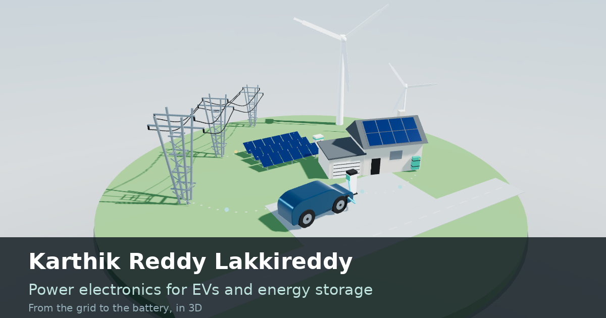

# Karthik Reddy Lakkireddy: portfolio

An interactive 3D portfolio about power electronics, battery management and EV charging, from the grid to the battery.

**Live site:** https://karthik-portfolio.lakkireddykarthikreddy8-bf6.workers.dev/



## What it is

A 3D energy scene on the left: grid pylons, wind turbines, a PV field with its inverter, a house with storage, a charging post and an electric car with its battery and on-board charger. Each object stands for one of my projects. Click an object, or scroll the profile on the right, and the camera moves to match.

| Year | Work |
|---|---|
| 2018 to 2022 | B.E. Electrical and Electronics Engineering, Osmania University |
| 2020 | Internship at my college: two-stage grid-tied inverter with dq0 current control and MPPT |
| 2022 | Bachelor thesis: bridgeless Landsman power factor correction converter |
| 2023 to 2026 | M.Sc. Elektro- und Mikrosystemtechnik, OTH Regensburg, including my own battery protection board in KiCad |
| 2025 to 2026 | Master's thesis at FEV GmbH: simulation of 350 kW fast charging with BMS current derating and state-of-health logic |
| Next | Energy storage systems and their management, and EV power electronics R&D |

The page also lists my certificates and tools.

## Thesis simulator

`simulator.html` is an illustrative recreation of my thesis GUI: Parameters, Graphs and Sankey tabs, with an ambient temperature selector. It uses assumed parameters and simplified physics. It is **not** thesis data.

## Built with

Plain HTML, CSS and JavaScript, and [three.js](https://threejs.org/) for the 3D scene. The text lives in one Markdown file (`content.md`), and a small Python script (`build.py`) turns it into the finished page. No framework, no tracking.

## Repository

```
content.md            the text of the portfolio
build.py              builds the website from content.md
src/                  page template and simulator source
og-image.png          preview picture for link sharing
index.html            the finished page (generated)
simulator.html        the finished simulator (generated)
dist/  dist.zip       the finished site, ready to upload to a host
EDITING.md            how to edit and publish
```

To rebuild after editing `content.md`, run `python3 build.py` (Python 3.8 or newer, nothing else needed). More in [EDITING.md](EDITING.md).

## Contact

karthik743004@gmail.com

---

© 2026 Karthik Reddy Lakkireddy. All rights reserved.
